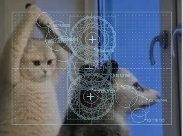

# Visual Effects

一个在本地处理图片、Logo 和视频的 Codex Skill。输入素材并描述效果，即可导出 PNG 或 MP4。支持工程图叠加、扫描框、CRT、VHS、数字故障、网点、竖线点描、抖动、ASCII、渐变映射和 Logo 呼吸发光。

## 工程图叠加示例

`schematic` 预设在原图上叠加浅蓝色网格、几何连线和坐标标记。



## 安装到 Codex

```sh
mkdir -p "$HOME/.agents/skills"
git clone --depth 1 https://github.com/bbds2802-maker/visual-effects.git "$HOME/.agents/skills/visual-effects"
```

本地渲染需要一个能导入 Pillow 11 或更新版本及 NumPy 的 Python 环境。已有环境可直接复用，也可以在仓库目录创建一个虚拟环境。

```sh
python3 -m venv .venv
.venv/bin/python -m pip install 'Pillow>=11' numpy
```

渲染视频还需要 PATH 中的 `ffmpeg` 和 `ffprobe`。使用虚拟环境时，可以把该环境的 Python 路径告诉 Codex。

## 用法

发给 Codex 一张图，然后输入：

> 用 $visual-effects 给这张图做工程图叠加，线条淡一点，偏青色。

也可以直接运行脚本。多个 `--effect` 会按输入顺序叠加。

```sh
.venv/bin/python scripts/render.py input.png output.png --effect schematic
.venv/bin/python scripts/render.py input.mp4 output.mp4 --effect crt:0.55 --effect glitch:0.18
```

[查看全部预设和参数说明](SKILL.md)
